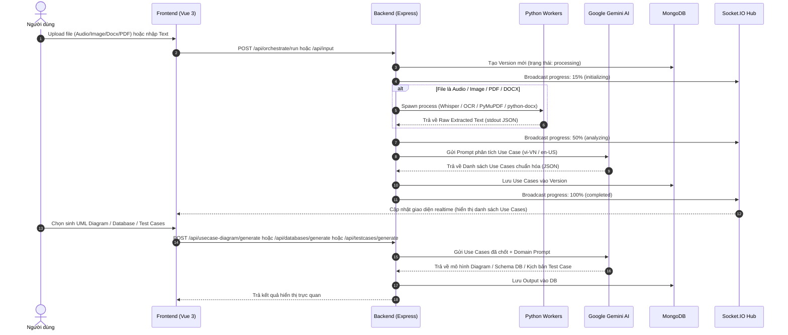

# 01. Tổng quan Kiến trúc Hệ thống SmartSpec (Architecture Overview)

## 1. Giới thiệu dự án SmartSpec
**SmartSpec** là một nền tảng kỹ nghệ yêu cầu phần mềm thông minh (AI-Powered Software Specification & Modeling Platform). Hệ thống giúp các Product Manager (PM), Business Analyst (BA), Software Architect và Developer tự động hóa quá trình chuyển hóa các tài liệu yêu cầu hỗn hợp, đa nguồn thành bộ đặc tả phần mềm hoàn chỉnh và chuyên nghiệp.

### Các bài toán cốt lõi SmartSpec giải quyết:
1. **Thu thập yêu cầu đa phương thức (Multi-Modal Requirements Ingestion)**: Tiếp nhận âm thanh cuộc họp (Audio), biên bản họp viết tay/chụp ảnh (OCR Image), tài liệu Word (DOCX), tài liệu PDF và văn bản thô (Text).
2. **Chuẩn hóa và trích xuất Use Cases (AI Extraction & Normalization)**: Sử dụng các mô hình ngôn ngữ lớn (Google Gemini AI) kết hợp prompt engineering chuyên sâu để trích xuất danh sách Use Cases, Actors, Goals, Tasks, Inputs, Outputs, Business Rules và Pre/Post-conditions.
3. **Phân tích gia tăng & Giải quyết xung đột (Incremental Analysis & Conflict Resolution)**: Cho phép nạp thêm tài liệu bổ sung theo thời gian, tự động so sánh ngữ nghĩa, phát hiện xung đột và hỗ trợ hợp nhất (Merge/Override) mà không làm mất dữ liệu hiện tại.
4. **Tự động sinh mô hình UML (UML Diagram Generation)**:
   - **Use Case Diagram**: Phân tích quan hệ Actor - Use Case, quan hệ include/extend.
   - **Activity Diagram**: Luồng xử lý công việc dạng swimlane, rẽ nhánh decision/merge.
   - **Sequence Diagram**: Tương tác tuần tự giữa Actor, UI, Controller, Service, Database kèm các khối alt/opt/loop.
5. **Đề xuất thiết kế Cơ sở dữ liệu (AI Database Design / ERD)**: Suy luận thực thể (Tables), thuộc tính (Columns, Data types, Primary/Foreign Keys, Constraints) và quan hệ giữa các bảng (1-1, 1-N, N-N), cung cấp giao diện trực quan hóa ERD canvas tương tác.
6. **Tự động sinh và kiểm thử Test Cases (Test Case Generation & Execution)**: Sinh bộ ca kiểm thử toàn diện (Integration, UI, API, Security, Performance), ánh xạ chặt chẽ với Use Case và Database, hỗ trợ chạy testcase và xuất báo cáo (Excel, CSV, PDF, JSON).
7. **Cộng tác & Phiên bản hóa (Real-time Collaboration & Version Control)**: Hỗ trợ nhiều người dùng cùng làm việc trên một dự án thông qua WebSocket (Socket.IO), theo dõi hiện diện (Presence), quản lý phiên bản Semantic Versioning (v1.0, v1.1...).

---

## 2. Kiến trúc tổng thể hệ thống (System Architecture)

Hệ thống được thiết kế theo mô hình **Distributed Modular Monolith** kết hợp **Python Worker Subprocesses** và **Event-Driven Realtime Communication**:

```
+-----------------------------------------------------------------------------------+
|                                CLIENT LAYER (FRONTEND)                           |
|  Vue 3 + Vite + Pinia + Vue Router + Tailwind CSS + Axios Client + Socket.IO Client|
+-----------------------------------------------------------------------------------+
                                   │                 ▲
                      RESTful HTTP │                 │ WebSockets (Socket.IO)
                       (Port 8000) │                 │ Realtime Events & Logs
                                   ▼                 │
+-----------------------------------------------------------------------------------+
|                        BACKEND INGRESS (Node.js / TypeScript)                    |
|  - Express Application (App.ts, Routing, Auth Guards, Recover Middleware)        |
|  - Realtime Hub (Socket.ts, PresenceService, LogSocketService, InputSocket)       |
|  - Modular Monolith Architecture (Clean Feature Slices: adapter -> domain)       |
|                                                                                   |
|  ┌─────────────────────────────────────────────────────────────────────────────┐  |
|  │                         MULTI-SOURCE EXTRACTION ENGINE                      │  |
|  │  DocxService     PdfService     SpeechToTextService    OcrService   Text    │  |
|  └───────┬──────────────┬──────────────────┬───────────────────┬─────────┬─────┘  |
+──────────┼──────────────┼──────────────────┼───────────────────┼─────────┼────────+
           │              │                  │                   │         │
           ▼              ▼                  ▼                   ▼         │
   ┌──────────────┐┌──────────────┐  ┌──────────────┐    ┌──────────────┐  │
   │ python-docx  ││ PyMuPDF      │  │ OpenAI       │    │ EasyOCR      │  │
   │ Process      ││ Process      │  │ Whisper +    │    │ PyTesseract  │  │
   │ (.docx)      ││ (.pdf)       │  │ Librosa (STT)│    │ OpenCV (OCR) │  │
   └──────────────┘└──────────────┘  └──────────────┘    └──────────────┘  │
           │              │                  │                   │         │
           └──────────────┴──────────────────┴───────────────────┴─────────┘
                                          │
                                Raw Text & Metadata
                                          ▼
+-----------------------------------------------------------------------------------+
|                              AI ORCHESTRATION ENGINE                              |
|  - OrchestratorService: Điều phối pipeline, quản lý trạng thái, tính hash file     |
|  - ApiKeyService: Pool quản lý API Key thông minh (Gemini/Claude/OpenAI)          |
|  - GeminiService (Extraction, UML, Database, Testcase)                            |
|  - RequirementService: Chuẩn hóa, bóc tách cấu trúc Use Case Schema               |
|  - VersionService: Tự động bump version, quản lý semantic versioning              |
+-----------------------------------------------------------------------------------+
             │                                                     │
             ▼                                                     ▼
+-------------------------+                               +-------------------------+
|     DATA PERSISTENCE    |                               |       CACHE & CDC       |
|   MongoDB Replica Set   | ◄─── MongoDB Change Streams ──┤       Redis Feeds       |
|  - Users, ApiKeys       |     (mongodb-redis-connector) |  - Sessions, Feed Cache |
|  - Projects, Versions   |                               |  - Lock & Ephemeral State|
|  - Inputs, Outputs      |                               +-------------------------+
|  - Diagrams, Databases  |
|  - Testcases, Logs      |
+-------------------------+
```

---

## 3. Các thành phần chính của hệ thống

### 3.1. Frontend Application (`frontend/`)
- **Công nghệ**: Vue 3 (Script Setup & Composition API), Vite build tool, Pinia state store.
- **Vai trò**:
  - Cung cấp giao diện trực quan cho người dùng tương tác với hệ thống.
  - Tích hợp Canvas vẽ biểu đồ tương tác cho sơ đồ quan hệ Database (ERD) và Activity Canvas.
  - Tích hợp Mermaid.js và PlantUML renderer cho Use Case Diagram và Sequence Diagram.
  - Quản lý phiên làm việc, phân quyền JWT (Admin Guard, Auth Guard), cơ chế auto-refresh token transparent với người dùng.
  - Lắng nghe sự kiện WebSocket realtime để hiển thị tiến độ phân tích (Progress Bar 0-100%) và danh sách thành viên đang truy cập (Active Users Presence).

### 3.2. Backend Ingress Service (`backend/executable/command-ingress/`)
- **Công nghệ**: Node.js v20+, TypeScript, Express.js.
- **Vai trò**:
  - Đóng vai trò API Gateway và Backend chính xử lý mọi nghiệp vụ.
  - Phân chia theo kiến trúc Clean Feature Modules: mỗi feature (như `usecase`, `database`, `uml`, `auth`, `project`) gồm 2 tầng chính:
    - **Adapter Layer**: Quản lý routes (`route.ts`) và controllers (`controller.ts`), xử lý request/response và validate dữ liệu.
    - **Domain Layer**: Chứa toàn bộ business logic (`service.ts`, `GeminiService.ts`, `interfaces.ts`).
  - Giao tiếp với các Python Worker thông qua cơ chế `child_process.spawn`.

### 3.3. Python Subprocess Extraction Engine
- **Công nghệ**: Python 3.10+, PyTorch, OpenAI Whisper, EasyOCR, Tesseract, PyMuPDF, Librosa, Noisereduce, python-docx.
- **Vai trò**:
  - Thực hiện các tác vụ nặng về AI máy tính:
    - Nhận dạng giọng nói (STT): Tiền xử lý lọc nhiễu âm thanh, chuyển audio cuộc họp thành transcript.
    - Nhận dạng ký tự quang học (OCR): Tiền xử lý ảnh (grayscale, thresholding, deskew), bóc tách chữ tiếng Việt và tiếng Anh từ ảnh/PDF scan.
    - Bóc tách văn bản DOCX: Đọc paragraph, heading, bullet points, bảng biểu từ file Word.
    - Bóc tách PDF: Trích xuất text native hoặc kết hợp OCR nếu là PDF dạng scan.

### 3.4. AI Orchestration & Generation Engine
- **Công nghệ**: Google Gemini API (`@google/genai` & `@google/generative-ai`), dynamic key rotation.
- **Vai trò**:
  - Xử lý ngôn ngữ tự nhiên hiểu sâu (NLU) yêu cầu người dùng.
  - Chuyển đổi văn bản phi cấu trúc thành cấu trúc dữ liệu JSON chặt chẽ (`RequirementModel`).
  - Tự động sinh:
    - Sơ đồ UML (Use Case, Activity, Sequence) với cấu trúc Nodes/Edges và script Mermaid.
    - Lược đồ cơ sở dữ liệu quan hệ (bảng, cột, kiểu dữ liệu, khóa chính, khóa ngoại, quan hệ).
    - Bộ kịch bản kiểm thử (Test Cases) chi tiết với các bước thực hiện, dữ liệu test và kết quả kỳ vọng.

### 3.5. MongoDB & Redis Persistence
- **MongoDB**:
  - Lưu trữ toàn bộ dữ liệu thực thể nghiệp vụ: Users, Projects, Versions, Inputs, Usecases, Diagrams, Databases, Testcases, Activity Logs, Notifications.
  - Cấu hình chạy dạng Replica Set (`rs0`) để hỗ trợ MongoDB Change Streams.
- **Redis**:
  - Lưu trữ session phiên làm việc tạm thời.
  - Dùng trong `mongodb-redis-connector` cho kiến trúc CDC (Change Data Capture) đồng bộ dữ liệu sự kiện.

---

## 4. Mô hình tương tác dữ liệu (Data Flow)


