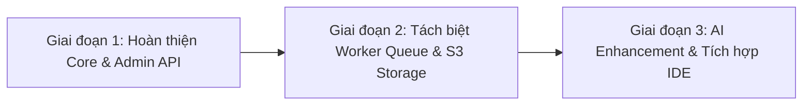

# 09. Đánh Giá Hiện Trạng Dự Án & Lộ Trình Phát Triển (Project Review & Roadmap)

Tài liệu này cung cấp một bản phân tích, đánh giá kỹ thuật khách quan và toàn diện về toàn bộ dự án **SmartSpec**, chỉ rõ các điểm mạnh, các khoản nợ kỹ thuật (Technical Debt) còn tồn đọng và đề xuất lộ trình hoàn thiện (Roadmap).

> Audit ngày 2026-11-13. Build được kiểm tra; test hiện có chỉ bao phủ validator, chưa có E2E với MongoDB, Redis, Google OAuth hoặc LLM credentials. Vì vậy chưa thể kết luận mọi luồng đã hoàn thiện hoặc production-ready.

---

## 0. Cập nhật bảo mật (2026-11-14)

Đã xử lý: OTP 2FA dùng HMAC + `JWT_OTP_SECRET` + `crypto.randomInt`; thêm `helmet` và rate limit (`middlewares/rateLimit.ts`) cho auth/orchestrate; chỉ public `/uploads/avatars`; giới hạn kích thước file upload; sanitize `v-html` bằng DOMPurify (`frontend/src/utils/sanitize.js`); `PYTHON_PATH` cấu hình được; middleware phân quyền theo project (`middlewares/projectAccess.ts`, vai trò owner/editor/viewer) áp cho database, testcase, version, ai_copilot và 3 loại UML; thêm test và CI (`.github/workflows/ci.yml`).

Còn lại: hàng đợi worker cho OCR/STT, object storage, giảm `any`/`console.*`, tách các view lớn, kiểm tra phân quyền cho các feature chưa guard (input, log, orchestrator) bằng integration test.

---

## 1. Đánh giá Điểm Mạnh của Dự Án (Key Strengths)

1. **Ý tưởng Sản phẩm Đột phá & Tính Ứng dụng Cao**:
   - Tự động hóa khâu thu thập và chuẩn hóa yêu cầu phần mềm - vốn là khâu tốn nhiều nhân lực và dễ sai sót nhất trong vòng đời phát triển phần mềm (SDLC).
   - Tiếp cận bài toán đa phương thức thực tế (audio cuộc họp, ảnh chụp bảng trắng, tài liệu word/pdf scan).

2. **Kiến trúc Phân tầng Rõ ràng (Modular Monolith & Clean Architecture)**:
   - Tách biệt rõ ràng giữa `adapter` (HTTP, routing, controller) và `domain` (business logic, services).
   - Mô hình module độc lập giúp các lập trình viên có thể làm việc song song trên các tính năng khác nhau (`database`, `testcase`, `uml`, `usecase`) mà không bị xung đột code.

3. **Kỹ thuật Prompt Engineering Chuyên sâu**:
   - Bộ prompt được xây dựng rất công phu trong `GeminiService.ts`: định hướng rõ ràng cho AI phân biệt giữa hành vi người dùng ngoài đời thực và hành vi chức năng phần mềm, áp đặt định dạng JSON nghiêm ngặt để parser hoạt động ổn định.

4. **Trải nghiệm Thời gian thực (Real-time Collaboration)**:
   - Tích hợp Socket.IO với các kênh chuyên biệt: Presence (theo dõi ai đang xem cùng màn hình), Progress Updates (tiến độ phân tích AI từng % mượt mà), Logs Streaming.

5. **Bộ tính năng Hậu phân tích (Post-Extraction Ecosystem) Phong phú**:
   - Không chỉ dừng lại ở trích xuất Use Case, hệ thống cung cấp trọn gói từ Sinh sơ đồ UML (Mermaid/PlantUML), Lược đồ CSDL quan hệ tương tác (Canvas ERD), đến Kịch bản kiểm thử (Test Cases Execution & Multi-format Export).

6. **Quản lý Pool API Key Độc lập & Thông minh**:
   - Lưu trữ và tự động luân chuyển (rotate) API Key trong database, tự động đánh dấu vô hiệu hóa (disable) khi key gặp sự cố quota hoặc lỗi ủy quyền.

---

## 2. Nhận diện Nợ Kỹ thuật & Hạn chế Hiện tại (Technical Debt & Limitations)

### 2.1. Phụ thuộc tên binary Python trong subprocess
- **Vấn đề**: Backend gọi bất đồng bộ các script Python qua `child_process.spawn('python', args)`.
- **Rủi ro**:
  - Tên nhị phân `python` khác nhau tùy môi trường (trên Linux/macOS thường là `python3`).
  - Nếu có nhiều người dùng cùng upload file audio dung lượng lớn hoặc ảnh OCR cùng lúc, việc spawn tiến trình Python nặng về CPU/RAM trực tiếp trên Node.js server sẽ gây nghẽn (CPU Starvation) và làm chậm toàn bộ server Express.
- **Khuyến nghị**: Cấu hình `PYTHON_PATH` thay vì hardcode `python`, sau đó cân nhắc tách tác vụ nặng sang worker queue khi cần scale.

### 2.2. Khoảng cách API giữa Frontend và Backend (Admin Panel Gap)
- **Đã xác minh thiếu**: Frontend gọi `GET /api/admin/dashboard/stats`, `GET /api/admin/dashboard/activities`, `GET /api/admin/system/info`, `GET /api/admin/system/logs`, `PATCH /api/users/:id/status` và `POST /api/users/bulk-action`, nhưng các route này chưa được mount ở backend.
- User CRUD, API key CRUD và admin project list đã có route cơ bản. Tạo user từ Admin hiện dùng public registration endpoint; cần endpoint admin-only trước khi coi chức năng này hoàn tất.
- Chi tiết hợp đồng và trạng thái route: [docs/07-api-reference.md](07-api-reference.md).

### 2.3. Thiếu Quản lý File Upload tập trung (Object Storage)
- **Vấn đề**: File upload hiện được lưu trực tiếp trên ổ cứng cục bộ (`backend/uploads/`, `uploads_Audio/`, `uploads_docx/`).
- **Rủi ro**: Không khả thi khi scale horizontal (chạy nhiều bản sao Backend trên Docker Swarm hoặc Kubernetes).
- **Khuyến nghị**: Tích hợp S3-compatible Object Storage (MinIO, AWS S3 hoặc Cloudflare R2) để quản lý file an toàn và tập trung.

### 2.4. File Vue Views có độ dài quá lớn (Monolithic Components)
- **Vấn đề**: Một số file Vue trong `frontend/src/views/` có dung lượng từ 1.500 đến 2.500 dòng code (ví dụ: `AdminDashboard.vue` 2.478 dòng, `UmlManagement.vue` 2.390 dòng, `TestcaseManagement.vue` 2.301 dòng).
- **Khuyến nghị**: Tách nhỏ các logic tính toán (computed, methods) thành các **Vue Composables** (`useTestcases.js`, `useUmlDiagram.js`, `useAdminStats.js`) và tách các khối giao diện con thành components riêng biệt.

### 2.5. Thiếu kiểm thử tự động và lint chưa đạt
- Backend hiện có 4 unit tests cho validation; frontend chưa có test suite component/E2E.
- Lint hiện thất bại trên nhiều file ở cả hai ứng dụng; cần xử lý theo module, không auto-fix toàn repo vì dễ tạo diff lớn và che lỗi chức năng.
- Build pass không chứng minh Google OAuth, xử lý file Python, pipeline LLM, Redis realtime hoặc các thao tác CRUD chạy end-to-end.

### 2.6. Orchestrator ghép input bằng time-window
- `getNewlyCreatedInputs()` hiện tìm input mới trong 10 giây theo version; đây là heuristic và có thể trộn input của một request khác khi có upload đồng thời.
- Ưu tiên truyền rõ input IDs theo từng request để correlation không phụ thuộc thời gian.

---

## 3. Lộ trình Nâng cấp Đề xuất (Development Roadmap)

### Giai đoạn 1: Hoàn thiện Core & Admin API (Ưu tiên cao)
- [ ] Hoàn thiện hoặc gỡ các màn hình gọi API Admin còn thiếu theo `docs/07-api-reference.md`.
- [ ] Bổ sung integration tests cho auth, project/version, usecase, upload/extraction và Admin.
- [ ] Sửa lint theo từng feature và thêm CI để chặn lỗi mới.
- [ ] Chuẩn hóa biến môi trường `PYTHON_PATH` trong `.env` để linh hoạt chỉ định đường dẫn thực thi của Python venv (`venv/bin/python`).
- [ ] Bổ sung cơ chế Rate Limiting (dùng `express-rate-limit`) cho các endpoint công khai như `/api/auth/login`, `/api/auth/register`, `/api/orchestrate/run`.

### Giai đoạn 2: Tách biệt Worker Queue & S3 Storage (Kiến trúc & Hiệu năng)
- [ ] Chuyển các tác vụ OCR / STT / Docx sang background job với **BullMQ** + Redis.
- [ ] Hiển thị thanh tiến trình xử lý dựa trên job events của BullMQ truyền qua Socket.IO.
- [ ] Thay thế lưu trữ file local bằng S3 / MinIO.

### Giai đoạn 3: AI Enhancement & Tích hợp Hệ sinh thái
- [ ] Hỗ trợ thêm nhiều LLM Provider (Anthropic Claude 3.5 Sonnet, OpenAI GPT-4o) bên cạnh Google Gemini.
- [ ] Cho phép chỉnh sửa trực tiếp biểu đồ Mermaid / PlantUML với Live Preview và hai chiều đồng bộ (Two-way Sync) với Use Case Schema.
- [ ] Xuất mã nguồn khung (Boilerplate Code Generation): Tự động sinh DTOs, Controllers và Migrations (Prisma / TypeORM / SQL) từ Lược đồ CSDL đã thiết kế.
